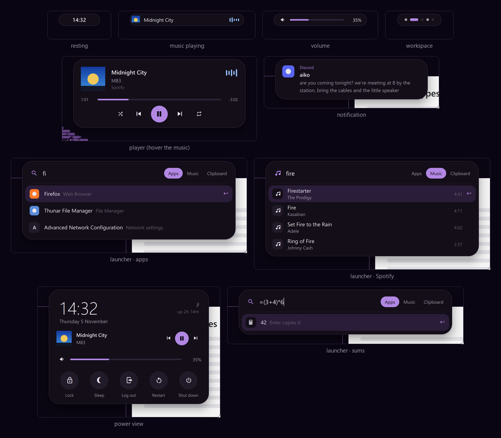

# shinrai · 信頼

A dark violet Hyprland desktop with purple accents, for **Arch Linux + Hyprland 0.57+**. There's no bar: one dark island at the top middle does everything, like the notch on a Mac or the Dynamic Island on an iPhone.



*(preview rendered on Windows with mock data and Segoe UI standing in for Inter)*

- **Resting:** a small pill with the time.
- **Music playing:** the cover, the song and a little waveform that moves with the music, tinted with the cover's color. When you pause, it goes back to the time after a few seconds; the paused song waits in the power view.
- **Player:** rest the mouse on it (or click) and it opens into a player: cover, title, artist, seek bar, shuffle, previous, play/pause, next, repeat. It closes when the mouse leaves.
- **Launcher** (`Super + Space`): apps, Spotify search and clipboard history in one, plus sums and power words.
- **Power view** (click the time, or `Super + Shift + E`): the time and date, the current song with previous / play / next (also while paused), a volume slider, and lock, sleep, log out, restart, shut down.
- **Notifications:** the island turns into the notification, one at a time.
- **Hints:** for a moment after you change the volume or switch workspaces.
- **Login screen** (after a reboot or when you log out): the same picture, drawn as an SDDM theme. Type your password into the island and press Enter; a wrong one shakes it.
- **Lock screen** (`Super + L`, and after 10 idle minutes): the desktop at rest, with the wallpaper, the island showing the time and the date under it. Start typing and the island becomes the password field; a wrong password stretches it to say so, then it fades back to the time.

Every change of shape runs on spring physics, and new content fades in with a short blur (on real hardware). Changes that interrupt each other blend together instead of starting over.

The island is near-black with light text and a faint purple outline. The wallpaper's purple marks whatever is on or chosen: the sliders, the play button, the launcher's tab and highlighted row, the current workspace, shuffle and repeat when they're on, and a power button waiting for you to confirm.

The wallpaper (`wallpaper.png`, 2000×1125) is two hands reaching for each other, drawn in purple ASCII on a dark violet. It fills each screen; on screens wider than 16:9 the top and bottom are cropped, and the hands stay in view. At 2000 pixels wide it looks a little soft on bigger screens.

---

## Stack

| Part | Tool |
|---|---|
| Compositor | Hyprland 0.57+ (Lua config: `~/.config/hypr/hyprland.lua`) |
| Island, wallpaper, notifications | Quickshell 0.3+ (`~/.config/quickshell/shinrai`) |
| Music | Spotify Soloist in the background (searched and played from the launcher), or any MPRIS player (Spotify app, Firefox, mpv, …) |
| Waveform | cava |
| Clipboard history | cliphist |
| Terminal | kitty, on the wallpaper's dark violet, with a purple gliding cursor |
| Editor | Neovim 0.12 with a colorscheme of its own (violet greys, purple keywords); plugins optional, through its built-in `vim.pack` |
| System info | fastfetch: small, with the wallpaper's two fingertips as its logo |
| Lock / idle | hyprlock / hypridle |
| Login screen | SDDM, with the shinrai theme |
| Fonts | Inter (island), JetBrainsMono Nerd Font (terminal, icons) |
| Shell | zsh with a `~ ›` prompt, violet greys and a purple arrow |

All packages are in the official Arch repos. The exception is Spotify Soloist, which the installer downloads from Spotify.

---

## Install

1. Clone the repo on the Arch machine:

   ```bash
   git clone https://github.com/icxd/dots ~/dots
   ```

2. Run the installer **as your normal user** (it calls `sudo` itself):

   ```bash
   cd ~/dots && bash install.sh
   ```

   What it does:
   - Installs the packages with `sudo pacman -Syu --needed` (see the list in `install.sh`).
   - If mako, dunst or swaync is installed, it offers to remove it. The island is the notification daemon now, and another daemon could take notifications from it.
   - Puts the previous rice (noir) aside. Its scripts and configs are moved into `~/.local/share/shinrai/noir-leftovers-<time>/`. Your Spotify keys move to `~/.config/shinrai/spotify.env`, the Soloist download is reused, and the Spotify app's purple theme is undone (`spicetify restore`).
   - Copies every config into `~/.config/...`. Anything already there is renamed to `*.bak-<time>` first, never deleted.
   - Installs and starts the `soloist` user service, the music player.
   - If SDDM is your login manager, installs the shinrai login screen into `/usr/share/sddm/themes/shinrai` and picks it in `/etc/sddm.conf.d/shinrai.conf`. This asks for sudo, and only when something changed. It uses your current wallpaper.
   - Inside a running Hyprland session it starts the new shell right away.

   Options:
   - `bash install.sh --link` symlinks the configs to this folder instead of copying them, so edits in the folder apply live.
   - `bash install.sh --no-packages` only places the configs.

3. Check the Hyprland config, then log out and back in:

   ```bash
   Hyprland --verify-config -c ~/.config/hypr/hyprland.lua
   ```

4. Optional: make zsh your login shell:

   ```bash
   chsh -s /usr/bin/zsh
   ```

To update, pull and re-run the installer without packages:

```bash
cd ~/dots && git pull && bash install.sh --no-packages
```

---

## Keys

| Keys | Action |
|---|---|
| `Super + Space` / `Super + D` | launcher (apps) |
| `Super + A` | launcher, Spotify search |
| `Super + C` | launcher, clipboard history |
| `Super + Shift + E` | power view (logs out straight away if the shell isn't running) |
| `Super + Return` | terminal |
| `Super + E` | files (thunar) |
| `Super + L` | lock |
| `Super + Q` | close window |
| `Super + V` / `F` / `M` | float / fullscreen / maximize |
| `Super + J` / `P` | toggle split / pseudotile |
| `Super + ←↑→↓` / `+ Shift` | move focus / move window |
| `Super + 1…0` / `+ Shift` | go to workspace / send window there |
| `Super + S` / `+ Shift` | scratchpad / send to scratchpad |
| `Super + scroll`, 3-finger swipe | cycle workspaces |
| `Super + drag` (left / right) | move / resize window |
| `Super + Shift + R` | restart the shell (island + wallpaper); also clears out a stray second copy |
| `Print` / `Shift + Print` | region → clipboard / screen → `~/Pictures/Screenshots` |
| media and volume keys | go through the island, which shows the change |

## The island with the mouse

| On the island | |
|---|---|
| rest on the music | opens the player; leave and it closes |
| click | time → power view · music → player · notification → open it · volume → mute |
| right click | launcher (on a notification: dismiss it) |
| middle click | play / pause |
| scroll | volume |
| in the player | click the cover to bring the music app forward; drag the bar to seek |

## Launcher

Type to search. `Tab` switches between **Apps**, **Music** and **Clipboard** and keeps your text, so you can type `daft punk` and press `Tab` to search Spotify for it.

| | |
|---|---|
| `↑` `↓`, `Ctrl + J/K`, `PgUp/PgDn`, the mouse | pick |
| `Enter` / click | open the app, play the song, or copy the clipboard entry |
| `Shift + Enter` | add the song to the queue (the launcher stays open) |
| `Shift + Delete` | in Clipboard: forget that entry |
| `Esc`, click outside | close |

In Apps mode it also:
- **does sums:** `2*21`, `(3+4)^2`, `=15%4`. `Enter` copies the result.
- **knows power words:** `lock`, `sleep`, `log out`, `restart`, `shut down`.

Apps you open often move to the top.

## Power view

`l` lock · `s` sleep · `e` log out · `r` restart · `p` shut down · `m` play / pause. Or use `← →` and `Enter`, or click. Log out, restart and shut down ask once more: press the same key (or button) again within 3 seconds. Then your apps are asked to close first, as if you clicked their close buttons, so a browser keeps its tabs and an editor can ask about unsaved work. If one stays open (say, a "save changes?" dialog), nothing restarts: the island says which app, and you can try again once it's dealt with. `↑ ↓` change the volume, `Esc` closes.

---

## Terminal, shell and editor

Everything sits on the wallpaper's dark violet in violet-tinted greys, with the island's purple for the cursor, selections, the current tab, folders and keywords. Softer colors show up only where they mean something: errors, warnings, git changes.

**kitty**: a thin beam cursor that breathes and glides when it jumps, a little extra line spacing, and tabs only when there are two or more (the current one is a purple pill).

| | |
|---|---|
| `ctrl+shift+\` / `ctrl+shift+-` | split side by side / one above the other |
| `alt+arrows` | move between splits (the one you're not in fades back) |
| `ctrl+shift+z` | zoom the current split |
| `ctrl+shift+t` | new tab |

**zsh**: the prompt is `~/dots main ›`: path, git branch in dim purple, and a purple arrow that turns grey after a failed command. What you type is shaded as you go (commands white, keywords purple, arguments softer, mistakes soft red), with suggestions from history in dark grey (`→` takes one). `↑ ↓` search history for what you've typed. `ls`, `ll`, `la` and `tree` go through eza with folders in purple, and man pages open in Neovim.

**Neovim**: everything below is built into Neovim 0.12, so it works with no plugins at all. The mode sits in a small purple pill in the statusline.

| | |
|---|---|
| `Space f` | find a file: fuzzy, as you type |
| `Space b` | switch buffer |
| `Space /` | search the project (ripgrep), results in a list |
| `-` | file explorer (`gh` shows hidden files) |
| `Space d` | the diagnostic under the cursor |
| `gd`, `K`, `grn`, `gra`, `grr` | definition, hover, rename, code action, references |
| `Tab` / `Shift+Tab` | walk the completion menu, which opens as you type |

**Plugins** go through Neovim's own plugin manager, `vim.pack` (built into 0.12, nothing to install), and are listed in `~/.config/nvim/lua/plugins.lua`. Three come set up, all following tagged releases and styled by the colorscheme. The first start asks before downloading them; without them (say, offline) everything above still works.

- **gitsigns**: thin bars in the margin where lines changed. `]h` / `[h` jump between changes; `Space gp` preview, `gs` stage, `gr` undo, `gb` blame on or off.
- **oil**: `-` opens the folder as a plain buffer. Rename, move or delete files by editing the names, then `:w`. `g.` shows hidden files, and deleted files go to the trash.
- **mini.pick**: a floating picker in the middle. `Space f` files, `Space /` live search through the project with a preview, `Space b` buffers, `Space h` help, `Space '` reopens the last one. In the picker: `Tab` preview, `Ctrl-v` / `Ctrl-s` open in a split, `Esc` close.

To add another, put its address in the list and restart Neovim. Exact versions are pinned in `~/.config/nvim/nvim-pack-lock.json`.

| | |
|---|---|
| `:PackUpdate` | download updates and show what changed: `:write` applies them, `:quit` skips |
| `:PackList` | what's installed, at which version |
| `:PackClean` | after removing a plugin from the list (and restarting): delete it from disk |

To keep plugins across reinstalls, add them in this folder's `config/nvim/lua/plugins.lua` (or install with `--link`). `install.sh` carries your lockfile over.

Language servers start on their own if they're installed: `lua-language-server`, `basedpyright` or `pyright`, `typescript-language-server`, `clangd`, `rust-analyzer`, `gopls`, `bash-language-server`, and `qmlls` for the Quickshell files (from `qt6-languageserver`). Install the ones you want with pacman; `:checkhealth vim.lsp` shows what's running.

---

## Login screen

After a reboot or a log out, SDDM shows the island with the time. Just type your password (the island fills with dots) and press Enter.

| | |
|---|---|
| `Enter` | log in |
| `Esc` | clear what you typed |
| `Tab` | next user (with several users) |
| bottom row | click your name or the session to switch; restart; shut down |

It logs into the session you used last; click its name at the bottom to pick another. To see it without logging out (in a terminal; nothing logs in from there):

```bash
sddm-greeter-qt6 --test-mode --theme /usr/share/sddm/themes/shinrai
```

`shinrai-wall` doesn't reach the login screen (it lives outside your home); re-run `install.sh` afterwards to copy the new wallpaper there too.

---

## Music

The island follows whatever plays: Spotify Soloist, or another player like the Spotify app, Firefox or mpv. The launcher's Music mode searches Spotify and plays through **Spotify Soloist**, Spotify's own player running in the background with no window. When a song ends, Spotify's autoplay continues with similar ones.

Soloist and search both need **Spotify Premium** and two keys of your own. If you used noir, the installer already copied them over, so skip to step 4.

1. **Soloist key:** log in at [developer.spotify.com/dashboard/soloist](https://developer.spotify.com/dashboard/soloist) and generate a key.
2. **Developer app for search:** at [developer.spotify.com/dashboard](https://developer.spotify.com/dashboard), click **Create app**. Name it anything, use `http://127.0.0.1:8888/callback` as the redirect URI (it's never used), tick **Web API**, and save. Its **Settings** page shows the Client ID and Client secret.
3. Put them in `~/.config/shinrai/spotify.env`. Also set `SPOTIFY_MARKET` to your country's two letters. The file is only readable by you; don't share or screenshot it. Proofread it: a misspelled name is silently ignored. `grep -cE '^[A-Z_]+=.' ~/.config/shinrai/spotify.env` counts the settings that have a value: 5 when everything is filled in.
4. Start the player:

   ```bash
   systemctl --user restart soloist
   ```

5. Pair it once: in any Spotify app (the one in the launcher, or your phone on the same network), open the device picker and choose **Shinrai**. Soloist remembers the login.

**Pinned playlists** show in Music mode while the search box is empty. In Spotify use **Share → Copy link**, then add the link to `pinned` in `~/.config/quickshell/shinrai/config/Config.qml`:

```qml
property var pinned: [
    { name: "my playlist", uri: "https://open.spotify.com/playlist/..." },
]
```

Soloist builds expire after 90 days. When that happens, `shinrai-soloist` downloads the current build and starts again by itself. To update by hand, run `shinrai-soloist-update`.

---

## Customizing

| What | Where |
|---|---|
| Clock format, hover-to-open, workspace hint, how long hints and notifications stay, how long the music stays after pausing, launcher rows, waveform tint, pinned playlists | `~/.config/quickshell/shinrai/config/Config.qml` |
| Colors, fonts, the island's sizes | `~/.config/quickshell/shinrai/config/Theme.qml` |
| How bouncy / fast the island moves | the `Spring` blocks in `island/IslandWindow.qml` (`response` = seconds per swing, `damping` 1 = no bounce) |
| Monitors (see [Several monitors](#several-monitors)), gaps, borders, window animations, keys | `~/.config/hypr/hyprland.lua` |
| Lock screen (sizes are for scale 1; `shinrai-lock` multiplies them by your monitor's scale) | `~/.config/hypr/hyprlock.conf` |
| Login screen | `config/sddm/shinrai/Main.qml` in this folder, then re-run `install.sh` (it's copied to `/usr/share/sddm/themes/shinrai`) |
| Terminal | `~/.config/kitty/kitty.conf` (reload: `ctrl+shift+F5`) |
| Shell: prompt, colors while typing, ls colors | `~/.zshrc` |
| Editor: options and keys / colors / plugins | `~/.config/nvim/init.lua` / `colors/shinrai.lua` / `lua/plugins.lua` |
| fastfetch (which lines, logo size) | `~/.config/fastfetch/config.jsonc`; the logo is `shinrai.png` next to it |

Quickshell and Hyprland both reload by themselves when you save.

**Change the wallpaper:**

```bash
shinrai-wall ~/Pictures/something.jpg
```

This changes the desktop and the lock screen. The picture fills the screen, so its edges are cropped if its shape differs from the screen's.

### Several monitors

Every screen gets the wallpaper and its own island. The clock and the music show on all of them. The launcher, the power view, notifications and the volume open on the screen you're on, or on the one whose island you clicked. The workspace dots flash on the screen that switched, and not when the mouse merely moves to another screen.

`hyprland.lua` runs the VM's screen (`Virtual-1`) at scale 2, and any other screen at its highest resolution and fastest refresh rate, at scale 1. Hyprland lines the screens up left to right in the order it finds them. If that isn't the order on your desk, list their names:

```bash
hyprctl monitors all
```

Then give each one a line with its position, like the commented example in the MONITORS part of `hyprland.lua`.

The lock screen fits itself to the scale of the screen you're on. The login screen can't ask Hyprland, so `install.sh` writes the scale into its theme. After changing the scale, run `install.sh` from inside the desktop so the login screen matches. SDDM puts its island on the main screen (the others show the wallpaper). Which screen counts as main is up to the graphics driver; to choose it yourself, add an `xrandr --output <name> --primary` line to `/usr/share/sddm/scripts/Xsetup` (plain `xrandr` lists the names, which can differ from Hyprland's).

---

## Troubleshooting

- **No island:** run `shinrai-shell` in a terminal. QML errors print there with the file and line.
- **Something covers the launcher, or two islands seem to fight:** two copies of the shell are running, drawn on top of each other. `qs list -c shinrai` lists the running copies. `Super + Shift + R` (or `shinrai-shell --restart -d`) stops them all and starts one; `shinrai-shell` itself refuses to start a second copy.
- **`Could not find "shinrai" config directory`:** there's a `shell.qml` directly in `~/.config/quickshell/`, which hides named configs. Move it away. `install.sh` does this for you.
- **Hyprland config errors:** Hyprland shows a red banner, and `hyprctl configerrors` lists them. Outside a session, run `Hyprland --verify-config -c ~/.config/hypr/hyprland.lua`.
- **Keys do nothing** (`Super + Space` etc.): those keys reach the island through Quickshell's global shortcuts, so the shell has to be running. `hyprctl globalshortcuts` should list `shinrai:launcher`, `shinrai:music`, `shinrai:clipboard` and `shinrai:power`.
- **No notifications:** another daemon may own them. `busctl --user status org.freedesktop.Notifications` shows which program has the name; it should be `qs`. Remove the other one (`sudo pacman -Rns mako`) and restart the shell with `Super + Shift + R`.
- **The waveform doesn't move:** it moves only while music plays, and needs `cava` installed. Without cava it uses a gentle made-up motion instead.
- **Waveform tint stays purple:** the island takes it from the cover's colors. A cover that's mostly grey keeps the purple, and it needs `curl` for streamed covers.
- **Music mode:** the first row in the launcher says what's missing.
  - *"The player isn't running":* `systemctl --user status soloist` and `journalctl --user -u soloist`. Exit code 78 means there's no `SOLOIST_API_KEY` in `spotify.env` yet.
  - *"Pair the player once":* pick **Shinrai** in a Spotify app's device list.
  - *Spotify didn't accept the keys:* recheck the client ID and secret.
  - *No results for a song you know exists:* `SPOTIFY_MARKET` must be your account's country.
- **Running in a VM:** inside a VM, `shinrai-shell` and `shinrai-term` use software rendering, because virtual GPUs can't run Quickshell or kitty. The island then skips blur and shadows, which cost a lot of CPU there. If it still feels slow, give the VM more CPU cores, or in VMware turn on **Accelerate 3D graphics** (with the VM off). QEMU/virt-manager with virtio-gpu and OpenGL is fastest. To force the effects on or off, set `SHINRAI_EFFECTS=1` or `0` in the environment.

- **fastfetch shows a text logo instead of the picture:** the picture is drawn with kitty's image protocol, so it needs kitty, and fastfetch needs ImageMagick (`imagemagick` is in the package list). In other terminals or a TTY you get a text logo.

- **Log out shows the plain blue SDDM screen:** the shinrai theme isn't picked. `ls /usr/share/sddm/themes/shinrai` should list `Main.qml`, and `/etc/sddm.conf.d/shinrai.conf` should exist. If `/etc/sddm.conf` has a `Current=` line under `[Theme]`, delete it: that file wins.

- **Restart or shut down from the island does nothing:** look at the island right after; "Still open: …" names the app that didn't close. Close it, then try again. `~/.local/bin/shinrai-power reboot` in a terminal does the same thing and shows any error.

## Undo

Each replaced file was renamed to `<name>.bak-<time>` next to where it was. Delete the new one and rename the backup back. The previous rice's own files are in `~/.local/share/shinrai/noir-leftovers-<time>/`.

To go back to SDDM's own login screen: `sudo rm /etc/sddm.conf.d/shinrai.conf` (and `sudo rm -r /usr/share/sddm/themes/shinrai`).

To remove the music player: `systemctl --user disable --now soloist`, then delete `~/.local/share/shinrai/soloist` and `~/.config/shinrai/spotify.env`. Soloist keeps its login in `~/.local/share/soloist`; delete that folder too to unpair it.

## Layout of this folder

```
install.sh                installer
wallpaper.png             the wallpaper (2000×1125)
preview.png               the picture at the top of this README
bin/
  shinrai-shell           starts the shell (software rendering inside VMs)
  shinrai-term            starts kitty (same)
  shinrai-power           lock / suspend / logout / reboot / poweroff
  shinrai-lock            starts hyprlock, sized for the monitor's scale
  shinrai-wall            sets the wallpaper
  shinrai-soloist         runs Spotify Soloist (the soloist service uses it)
  shinrai-soloist-update  downloads the current Soloist build
config/
  hypr/                   hyprland.lua, hyprlock.conf, hypridle.conf, scripts/dpms.sh
  quickshell/shinrai/
    shell.qml             entry point: wallpaper, island, keys, IPC
    config/               Theme (look), Config (settings), Icons
    services/             Player, Soloist, Spotify, Audio, Cava, Apps, Clipboard,
                          Notifs, Session, Hub (what the island is asked to show)
    components/           Spring (the motion), Reveal (content in/out), PlayPause,
                          Waveform, Marquee, Cover, Slider, IconButton, Label, Glyph
    island/               IslandWindow and one file per view
    wallpaper/            the wallpaper layer
    assets/cava.conf      the waveform's cava feed
  kitty/  cava/           terminal and terminal-cava colors
  nvim/                   init.lua (options, keys, statusline, LSP), colors/shinrai.lua,
                          lua/plugins.lua (your plugins, through vim.pack)
  fastfetch/              config.jsonc and shinrai.png (its logo)
  systemd/user/           soloist.service
  sddm/shinrai/           the login screen theme (Main.qml, Spring.qml, BottomText.qml)
  sddm/shinrai.conf       goes to /etc/sddm.conf.d/, picks the theme
  shinrai/                spotify.env.example
home/.zshrc
```
